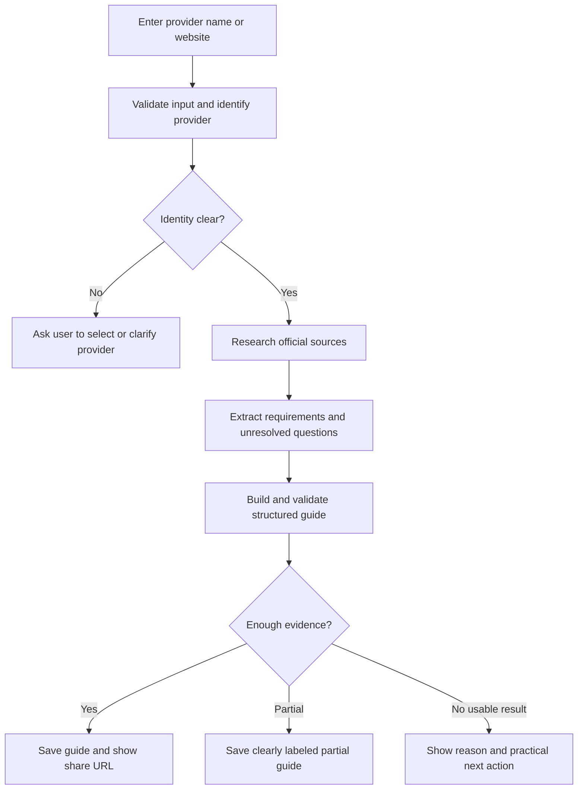
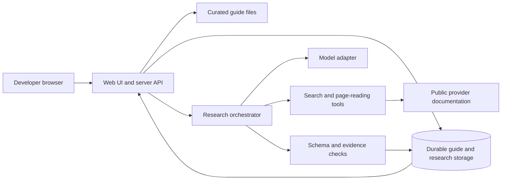

# OAuth App Guide — Project Specifics

**Last updated:** 21 October 2026 (Asia/Kolkata)  
**Current milestone:** Phase 8 complete; full 9-section launch plan architecture, multi-provider AI adapters (Anthropic Claude, Google Gemini, OpenAI), and submission documentation finalized.  
**Repository:** https://github.com/anushikapoddar/oauth-setup-guide  
**Local workspace:** `/Users/anushikapoddar/Desktop/OAuth-App-main`  

This is the living explanation of the project. It records what we are building, why, how the parts fit together, the evidence behind the guidance, and what actually works. `todo.md` tracks individual tasks. This document explains their outcomes.

## 1. How to keep this document current

At the end of **every phase**, before checking its completion box in `todo.md`:

1. Update the relevant sections here to reflect the actual result.
2. Add research sources, dates, findings, corrections, and access limitations.
3. Replace proposed architecture details with the implemented choices when those choices are made.
4. Add a phase journal entry: completed work, decisions, evidence or tests, remaining uncertainty, and next step.
5. Update the milestone above and the status table below.

At each phase completion, commit and push to `main` using a descriptive `type(scope): action` subject and a short body explaining the concrete changes and any verification limit. This follows the repository commit style requested by the owner.

Use these terms consistently: **researched** means a source was read; **observed** means a step was attempted and its result recorded; **planned** means we intend to build it; **implemented** means code exists; **verified** means a recorded check passed. An unchecked phase is unfinished even if its design is described here.

| Phase | Status | Result so far |
| --- | --- | --- |
| 1. Problem and scope | Complete | User, journey, scope, decisions, and acceptance criteria documented |
| 2. Provider research | Complete | GitHub, Google Calendar, and Slack compared against official sources; signed-in setup remains untested |
| 3. Guide schema | Complete | Versioned JSON Schema and human-readable page/evidence contract created |
| 4. Library and UI | Complete | Responsive Next.js application with searchable library and three standalone guides |
| 5. Live generation | Complete | Multi-provider research adapters (Anthropic Claude, Gemini, OpenAI), source validation, saved generated guides, and share URLs |
| 6. Guidance validation | Complete | Official sources verified for GitHub, Google, Slack, and Linear; credentials boundaries documented in docs/phase-6-validation.md |
| 7. Product testing | Complete | Local dev server running, Next.js production build verified (0 errors), typecheck verified, React key deduplication resolved |
| 8. Deployment and submission | Complete | Clean Git repository pushed to github.com/anushikapoddar/oauth-setup-guide; comprehensive PM README and submission artifacts finalized |

## 2. What problem are we solving?

A developer building an AI agent wants customers to connect services such as calendars, messaging tools, or business software. Before customers can connect, the developer may need to register an application with each service and satisfy its launch requirements. Those requirements are scattered across setup instructions, permission documentation, review policies, and provider dashboards.

Our product helps the developer answer: **Can I launch this integration, what must I do next, and what could delay me?** A useful result is a source-backed plan the developer can follow and share with a teammate.

Success means reducing uncertainty about the path to launch. A short registration form can coexist with a lengthy approval process; those must be shown separately.

## 3. The concepts in plain language

An **OAuth app** is the developer's registration with a provider. The **integration** is the developer's code that uses the provider's API. An **end user's connection** is that person's permission grant allowing the integration to access particular data. One registered app can serve many separately connected users; the app registration and each user's authorization are different objects. OAuth defines limited access on a user's behalf, client registration, scopes, and tokens. [R1]

| Term | Meaning in our project |
| --- | --- |
| Provider | The service the developer wants to integrate |
| Client ID | Identifier for the registered application |
| Client secret | Credential used by applicable client types; never requested by our guide product |
| Scope | A named permission such as reading calendar events |
| Redirect URI | Registered address used during the authorization flow |
| Access token | Credential used to make authorized API requests |
| Provider review | Provider-specific checks that may precede broader availability |
| User consent | An individual user's decision to authorize access |

The OAuth standard supplies protocol concepts; a provider's current documentation supplies its registration and review rules. The general journey below is a product model, not a claim that every provider has the same steps or ordering.

### Where MCP and Composio fit

MCP gives an agent application a standard way to discover and call tools exposed by servers. A tool may call an external provider, whose access requirements still need to be satisfied. An MCP endpoint can also have its own access controls; that is a separate boundary from authorization to the downstream provider. [R5]

Composio offers managed OAuth registrations for some supported methods and custom configurations for developer-owned registrations. Its directory describes both paths; availability must be checked for the actual method. Users still authorize their own accounts. [R2, R3]

**Our design decision:** explain the available setup paths early, including a managed option when verified. The product's core output is the developer's setup and approval guide. It does not need to operate the developer's integration or act as an OAuth token store.

## 4. Primary user and concrete demo scenario

**Primary user:** a developer or agent builder preparing a multi-user product for external customers, who knows what their agent should do but is unfamiliar with a provider's setup and approval process.

**Demo scenario:** a developer is building a meeting assistant that needs to read customers' calendar events. They look up Google Calendar, inspect the permissions and intended audience assumed by the guide, determine whether a managed registration meets their needs, and follow the applicable path to testing and launch. The exact permissions and review requirements will be researched during Phase 2. This scenario does not imply that the meeting assistant itself will be built.

For the unfamiliar-app demo, the evaluator enters a different provider by name or website. The product investigates it live and returns a shareable guide, or a clear partial/unsupported result when the evidence is insufficient.

### Decisions the developer needs help making

| Decision | What the guide must explain |
| --- | --- |
| Managed registration or own registration? | Availability, relevant constraints, and a link to the next action |
| Which permissions? | The feature they enable and how they change setup or review |
| Who will use the integration? | Test users, internal organization users, or external customers |
| What does “ready” mean? | Ready to test, ready to submit, waiting on review, or ready for the stated launch scenario |
| What can delay launch? | Missing account access, documents, domain ownership, provider review, or other documented prerequisites |
| What can the agent do? | Research, prepare, and explain; identify exact human or provider handoffs |

## 5. Phase 1 research and what it changes

Sources below were opened on **21 October 2026**. This is documentation research. No provider account, registration screen, consent flow, or approval process was tested in this phase.

| ID | Source | Finding used | Limit and product consequence |
| --- | --- | --- | --- |
| R1 | [IETF RFC 6749](https://www.rfc-editor.org/rfc/rfc6749) | Registration and user authorization are distinct protocol concepts | Used for definitions, not as a complete current implementation security checklist |
| R2 | [Composio managed OAuth directory](https://docs.composio.dev/toolkits/managed-auth) | Managed availability is per supported authentication method; custom registration can be required or chosen | The fetched page showed a loading state for individual toolkit entries. No per-provider availability has been confirmed here |
| R3 | [Composio authentication](https://docs.composio.dev/docs/authentication) | Configuration is reused while connected accounts belong to individual users | Guide UI must avoid confusing application credentials with user connections |
| R4 | [Google sensitive-scope verification](https://developers.google.com/identity/protocols/oauth2/production-readiness/sensitive-scope-verification) | Verification depends on requested access, with exceptions; provider documentation describes preparation and review | One provider cannot establish universal approval rules. Guides need conditions and a stated scenario |
| R5 | [MCP architecture](https://modelcontextprotocol.io/docs/learn/architecture) | Hosts, clients, and servers connect agents to capabilities | Tool access and provider setup belong in the explanation as distinct concerns |

### Findings translated into product choices

- **Difficulty needs context.** Show why a path is easy or difficult, alongside its audience and permission assumptions. This is our inference from the provider rules, not a universal provider score.
- **Work and waiting are different.** Show hands-on effort separately from approval wait. If no defensible wait estimate exists, show “Not published” or “Not verified.”
- **An account connection does not prove public launch readiness.** Track setup, testing, review, and launch as separate milestones.
- **Managed availability is worth checking first.** It may change which registration steps the developer needs to perform.
- **A citation alone does not prove a claim.** Important claims must point to source passages that actually support them, and uncertainty must remain visible.

## 5A. Phase 2 provider research

**Checked:** 21 October 2026. **Method:** read public, official provider and Composio documentation; compare the registration, permissions, test, distribution, and approval paths for one concrete use case per provider. These are researched findings, not completed provider registrations. No authenticated provider dashboard step, OAuth consent, or approval submission was observed. An attempt to access a running local browser for signed-in setup inspection timed out; the available in-app browser inventory contained no provider dashboard tab. Phase 6 will retry practical setup validation if access becomes available.

### Why these three

| Provider and sample scenario | Distinct challenge | Current launch interpretation |
| --- | --- | --- |
| **GitHub:** agent works with a customer's repository | Registration is self-service, but OAuth scopes can be broad and an organization may require owner approval | Registration looks relatively direct; access to particular organizations is conditional |
| **Google Calendar:** meeting assistant reads a customer's event details | External use of a sensitive calendar scope can require verification and supporting assets | Testing and external production must be described separately |
| **Slack:** agent posts into a customer's workspace | Distribution across workspaces, workspace admin controls, and optional Marketplace listing are different gates | An unlisted distributed app can be a pilot path; Marketplace listing adds a longer review path |

These are **scenario-specific product judgments**, not universal difficulty ratings. Section 7 and the guide contract now define the difficulty and effort rubric used to turn this research into guide pages.

### GitHub — repository agent

**Starting path:** A developer can register an OAuth app from GitHub account settings under Developer settings → OAuth apps → New OAuth App. Registration asks for an application name, homepage URL, and authorization callback URL. An organization owner can also register for an organization. GitHub's creation documentation itself recommends considering a GitHub App, which has more granular permissions and can act independently where appropriate. [R6]

**Permissions and approval:** An OAuth app with no scope can access public information, but the `repo` scope grants broad access to both public and private repositories; `public_repo` applies to public repositories. The scope cannot grant more access than the authorizing user already has. For an agent that needs private repository access, `repo` may be more permission than the product wants, so choosing GitHub App versus OAuth app is a real design decision. This is an inference from GitHub's scope model, not a claim that `repo` is always required for every repository feature. [R7] If an organization restricts OAuth app access, its owner must approve the app for that organization. That is an organization-specific access gate, not a universal central review of every OAuth app. [R8]

**Test and launch path:** Register app → configure callback and scope → connect a test GitHub user → verify intended API behavior → address organization policy for customer organizations that restrict access. Public documentation reviewed here does not publish a general wait time for organization owner approval. We found no central pre-launch review step in the cited creation flow; that absence does not prove no other GitHub policy applies. [R6, R8]

**Managed path:** Composio's managed-auth documentation lists GitHub among managed examples. A developer using that supported route may avoid registering their own GitHub OAuth client; custom registration is available when their own app identity or configuration is needed. The exact managed scope set and any product-specific constraints were not verified here. The Composio toolkit detail page failed to load during this research, so the guide must flag those details for confirmation. [R2, R18]

**Agent/human handoff:** An agent can compare GitHub App and OAuth app, map required operations to scopes, draft callback and test checklists, and explain organization approval. The developer must choose the permission model, sign in, register/configure the app, and protect client credentials. The customer or organization owner may need to authorize/approve access. [R6–R8]

**Timing and blocker:** Registration effort is not yet measured; no provider review duration is published in the cited flow. Organization approval wait is **unknown** and depends on each organization's owner. The first actionable decision is whether a GitHub App's granular permissions better fit the agent's repository actions. [R6–R8]

### Google Calendar — meeting assistant

**Starting path:** Create or select a Google Cloud project; configure Google Auth Platform branding, audience, and data access; then create an OAuth client for a web application and add the redirect URI. External testing uses explicitly added test users under the applicable publishing status. The current client-creation documentation includes an **AI-powered agent** designation and says that choice cannot be changed after creating the client; if both agent and standard app functionality are needed, it describes using separate clients. This detail should be surfaced before registration, not buried after a checklist. [R9, R10]

**Permissions and review:** Calendar exposes narrower scopes. `calendar.freebusy` supports availability data, while `calendar.events.readonly` supports reading event details; the chosen feature therefore changes the permission path. The sample meeting assistant needs event details, so `calendar.events.readonly` is the illustrative scope. Google's verification guide identifies access to calendar event content as sensitive. An external production app asking for sensitive scopes commonly needs verification unless an applicable exception applies. Internal or test-user usage must be assessed separately from external launch. [R4, R11]

**Preparation:** Google's documentation calls for accurate app identity, verified domain ownership, public homepage and privacy policy, scope justification, and a demonstration video for the verification request. The OAuth consent and production-readiness pages give the authoritative details. Google recommends separate test and production projects. [R4, R9, R12]

**Test and launch path:** Configure consent and client → add a test user → connect/test the flow → assemble verification assets → submit if the scope/audience combination requires it → wait for Google's decision before claiming broad production readiness. The sensitive-scope verification page says review **typically takes 3–5 business days**. That is a conditional provider review estimate, not total build time or a guarantee; requests can require follow-up. Hands-on effort has not been measured. [R4, R9]

**Managed path:** Composio documents a managed Google Calendar OAuth2 toolkit. The managed route changes which client the developer operates; it does not by itself prove the developer's intended product, scopes, branding, or compliance needs are covered. A custom client remains relevant when those requirements demand it. Confirm the supported managed scopes for the exact use case before recommending that path. [R18, R19]

**Agent/human handoff:** An agent can choose a narrow scope from the desired feature, draft app descriptions and scope justifications, inventory required policy pages, produce a submission checklist, and identify evidence gaps. The developer must own the Cloud project/domain, supply accurate product and policy information, configure credentials, perform test consent, and submit verification. Google makes the review decision. [R4, R9–R12]

**Likely blockers:** Missing domain verification or public policy pages; wrong audience/test-user configuration; requesting a broader scope than the feature needs; an incorrect redirect URI; creating the wrong client type/AI-agent designation. The initial next action is to decide whether the assistant needs event details or only free/busy availability, because that drives the scope and potential review path. [R4, R9–R12]

### Slack — cross-workspace posting agent

**Starting path:** Create an app through Slack's developer dashboard for a workspace, configure OAuth & Permissions, request the necessary scopes, and install it in a development workspace. `chat:write` is the bot scope for posting messages. A product serving other workspaces needs Slack's OAuth installation flow, including a configured redirect URL and the correct bot/user scope distinction. [R13, R14]

**Distribution and approval:** Installing in one workspace is different from enabling public distribution. Slack's distribution checklist describes enabling distribution so other workspaces can install through OAuth. Some customer workspaces require an admin to approve installation or restrict it altogether; the developer cannot make that customer decision. An unlisted distributed app and a Slack Marketplace listing are distinct paths. For commercial distribution, Slack's documentation says a Marketplace submission and approval are required; the guide should ask whether the proposed launch is a pilot or commercial public listing before offering a readiness judgment. [R15]

**Marketplace path:** Slack's review guide currently calls for installation/usage in at least 10 active workspaces in the preceding 28 days, testing in an external workspace, and a video covering installation, OAuth, usage, and uninstall. It describes preliminary feedback in up to **10 business days** and functional review taking up to **10 weeks** for new submissions; Slack's dashboard may show a current estimate. These are Marketplace-specific published ranges, not a wait for an unlisted pilot or a promise about any particular submission. [R16]

**Managed path:** Composio documents a managed Slack OAuth2 toolkit. It may simplify a developer's own client setup where its supported scopes and distribution model fit. It does not eliminate a customer's workspace installation/admin restrictions or establish Marketplace eligibility for the developer's product. Verify the actual managed configuration before promising a specific launch route. [R18, R20]

**Agent/human handoff:** An agent can map posting actions to scopes, draft install and redirect checklists, identify pilot versus listing requirements, prepare review artifacts, and suggest responses to blocked installations. The developer must register/configure the app, sign in to install/test it, handle credentials, and provide real external-workspace testing and product video. Customer admins control their workspace policies; Slack controls Marketplace review. [R13–R16]

**Timing and blocker:** Hands-on setup is unmeasured. Workspace admin wait for a specific customer is **unknown**. Marketplace timing has published conditional stages above. The first actionable decision is whether the intended launch needs a single-workspace test, an unlisted multi-workspace pilot, or Marketplace listing. [R15, R16]

### Source ledger for Phase 2

All pages below were opened or retrieved on **21 October 2026**. Provider policies and durations can change; the eventual guide should keep its own last-checked date and cite the relevant page beside the claim.

| ID | Official source | Supports / important limit |
| --- | --- | --- |
| R6 | [GitHub: Creating an OAuth app](https://docs.github.com/en/apps/oauth-apps/building-oauth-apps/creating-an-oauth-app) | Registration fields and GitHub App recommendation; no hands-on dashboard confirmation |
| R7 | [GitHub: OAuth scopes](https://docs.github.com/en/apps/oauth-apps/building-oauth-apps/scopes-for-oauth-apps) | Public access and breadth of `repo`/`public_repo`; exact API operation still needs checking |
| R8 | [GitHub: Approving OAuth apps for an organization](https://docs.github.com/en/organizations/managing-oauth-access-to-your-organizations-data/approving-oauth-apps-for-your-organization) | Conditional organization owner approval; no published universal wait |
| R9 | [Google: Configure OAuth consent](https://developers.google.com/workspace/guides/configure-oauth-consent) | Branding, audience, data access, testing setup |
| R10 | [Google: Create credentials](https://developers.google.com/workspace/guides/create-credentials) | Web client, redirect, AI-powered agent designation |
| R11 | [Google Calendar: Choose scopes](https://developers.google.com/workspace/calendar/api/auth) | Calendar capabilities and narrow scopes |
| R12 | [Google: OAuth policy compliance](https://developers.google.com/identity/protocols/oauth2/production-readiness/policy-compliance) | Production prerequisites and test/production separation |
| R13 | [Slack: App settings quickstart](https://docs.slack.dev/app-management/quickstart-app-settings/) | Create app, scopes, install for one workspace |
| R14 | [Slack: Installing with OAuth](https://docs.slack.dev/authentication/installing-with-oauth/) | Multi-workspace OAuth, scopes, redirect requirements |
| R15 | [Slack: Distribute your app](https://docs.slack.dev/app-management/distribution/) | Unlisted distribution, Marketplace distinction, customer admin restriction |
| R16 | [Slack: Marketplace review guide](https://docs.slack.dev/slack-marketplace/slack-marketplace-review-guide/) | Listing evidence, eligibility, and published review ranges; only applies to listing |
| R18 | [Composio: Managed app versus custom app](https://docs.composio.dev/docs/authentication/custom-app-vs-managed-app) | Managed/custom choice; must confirm exact method and scope support |
| R19 | [Composio: Google Calendar toolkit](https://docs.composio.dev/toolkits/googlecalendar) | Google Calendar OAuth2 toolkit and managed route |
| R20 | [Composio: Slack toolkit](https://docs.composio.dev/toolkits/slack) | Slack OAuth2 toolkit and managed route |

**Evidence boundary:** The pages above support a researched guide draft. They do not establish that our OAuth registration, redirect, consent, API access, provider verification, organization approval, or Marketplace review succeeds. No credentials were collected or created. The live product must carry this distinction into every generated guide.

## 6. Focused first release

### Included

1. A searchable library with **three researched guides** selected for contrasting setup challenges.
2. One consistent guide page containing prerequisites, steps, timing, blockers, evidence, and handoffs.
3. Submission of a provider name or website, including providers outside the library.
4. Real research using search/page-reading tools during generation, with visible progress.
5. Durable share URLs for curated and generated guides.
6. A small documented validation sample and a candid research/attempt log.
7. A deployed experience, repository, and short setup README.

The selected providers are **GitHub, Google Calendar, and Slack**. Section 5A explains their different permission, verification, and distribution challenges. The research is sufficient to design the sample guides; provider setup remains to be attempted where access permits.

### Deferred beyond the take-home

- Producing all 100 guides, scheduled refreshes, and a full editorial administration tool.
- Developer accounts, team collaboration, billing, and cross-device personal progress.
- Completing paid registrations, security assessments, or provider approvals.
- Building connectors, storing end-user tokens, or deploying MCP servers for customers.
- Fully automatic provider registration, provider email outreach, and unattended review submission.
- A production queue, continuous monitoring, and comprehensive abuse prevention.

Within the take-home, investigation can still attempt practical setup steps and record the point where account access or human input is needed. A finished approval is not a prerequisite for an honest, useful guide.

## 7. Guide content contract — finalized in Phase 3

The canonical human-readable contract is [docs/guide-contract.md](docs/guide-contract.md); the versioned machine-readable shape is [schema/guide.v1.schema.json](schema/guide.v1.schema.json). Both curated and generated guides use **schema version 1.0**. The first release renders a guide for **provider + capability + audience + registration path**, with explicit assumptions and a checked date. A partial guide uses the same shape but leads with its evidence gap and next investigation action.

The guide page order is: identity/scenario → readiness and next action → managed/custom choice → prerequisites → scopes → numbered stages → review → blockers → agent/human handoffs → evidence/limits. The detailed contract includes a worked, research-backed Google Calendar outline with direct provider links so the required writing style and page flow are concrete before implementation. It is not presented as a completed OAuth setup.

| Contract rule | Decision |
| --- | --- |
| Difficulty | Low, Moderate, High, or Unknown for the **stated launch scenario**; always give the gate or missing evidence driving the rating |
| Effort | Separate developer/agent hands-on time from provider/customer waiting; show “Not measured” until there is a task-based estimate or dry run |
| Wait | Use a provider-published conditional range, labeled estimate, Unknown, or supported Not applicable; never turn unknown into zero |
| Evidence | Label consequential claims `observed`, `official_source`, `estimated`, or `not_verified`; record dates and conditions |
| Step | State action, owner, condition, expected result, official URL when known, and the next action at each stage |
| Safety of representation | Only a matching attempt record can support `observed`; a documentation read is `official_source`, never a setup test |
| Sharing | Permanent guide URL renders a standalone page with title, scenario, checked date, sources beside claims, and no chat context required |

The JSON Schema checks required fields, enum values, and basic shapes. Application validation in Phase 4 must also resolve claim/source/attempt IDs, enforce unique IDs and stage numbering, reject an `observed` claim without a matching attempt, and apply guide-status rules. Phase 6 will check whether cited passages actually support important claims. This separation avoids treating structural validity as factual accuracy.

## 8. User flows

### A. Find a guide already in the library

1. Search by provider name.
2. Scan guide cards showing difficulty reasons, effort, wait, and the biggest blocker.
3. Open the guide and read its scenario assumptions.
4. Inspect managed versus custom registration guidance where relevant.
5. Follow prerequisites and numbered steps; open official sources as needed.
6. Use a blocker recovery section when stuck.
7. Copy the guide's permanent link and share it with a teammate.

The initial page presents a clear default scenario. Alternative cases appear as explicit conditional notes. If the user's case is outside the documented assumptions, the page explains that the guide may need further research.

### B. Generate a guide for an unfamiliar provider



Progress messages describe completed research stages. They must reflect actual work; a timer must not pretend that a source was checked. Invalid or failed results stay visibly distinct from completed guides.

### C. The provider setup journey described by a guide

Choose integration capability → choose registration path → obtain prerequisites → register/configure the app if needed → select permissions → test a user connection → prepare and submit required review → respond to provider feedback → launch for the supported audience.

This sequence includes conditional steps. Exact ordering, testing access, and launch criteria must come from each provider's evidence. Finishing our guide checklist does not itself grant provider approval.

## 9. Planned architecture

**Implementation status: design only.** The repository currently contains planning documents. The architecture below is the intended small application; exact vendors, package versions, and deployment configuration will be confirmed before implementation.



### Component responsibilities

| Component | Responsibility | Why it exists |
| --- | --- | --- |
| Web UI | Search, guide reading, generation form, progress, errors, and sharing | Makes a guide useful without an explanation from us |
| Server API | Validate requests, enforce limits, start research, serve saved results | Keeps credentials and trusted operations off the browser |
| Curated library | Reviewed guide data checked into the repository | Makes the demo library reproducible and easy to inspect |
| Research orchestrator | Drive identity resolution, source gathering, extraction, and drafting | Ensures generation includes actual investigation |
| Tool adapter | Search and read public source pages | Provides evidence independent of the model's recalled knowledge |
| Model adapter | Interpret sources and produce structured draft content | Allows model/API configuration without changing UI and storage contracts |
| Validator | Enforce schema, source IDs, required assumptions, and status rules | Catches structural omissions; semantic correctness still needs sampled review |
| Durable storage | Save generated guides, source metadata, run states, and versions | Lets a share URL work after refresh or a later visit |

### Implemented foundation and planned server additions

- **Next.js 16.4.2, React 19.2.6, and strict TypeScript** are implemented as one application. This keeps the guide UI and future Phase 5 server route together. The patched Next.js version was selected after the initially pinned starter version produced a critical npm advisory.
- **Plain responsive CSS** implements the visual system without a UI framework. This reduces dependencies while retaining keyboard focus states, reduced-motion handling, and breakpoints for narrow screens.
- **One shared content contract:** JSON Schema v1.0 is checked in and Ajv validates every curated guide during build rendering. A conversion layer maps the display model to the canonical contract, then checks schema shape, source references, claim references, and the rule that an observed claim needs an attempt record.
- **Curated TypeScript records** currently hold the three guides. A hosted database remains planned for generated guides because browser storage and process memory cannot provide durable share links.
- **One research agent with a bounded sequence of tool calls.** Separate stages do not require separate autonomous agents or a multi-agent framework.
- **One request with streamed progress** for the first version, bounded to the hosting platform's supported duration. Persist run status and final results. No promise of job continuation after process termination; interrupted runs must be marked or recovered as interrupted and offered a retry.
- **Plain guide URLs** that require no reviewer account to read. Generated content is public/shareable, so the submission form requests only provider information, not private business material or credentials.

The hosting, database, model, and search providers remain open decisions for Phases 5 and 8. Choose them based on available credentials, durable storage, supported request duration, and ease of setup.

## 10. Data and API design — proposed

### Core records

| Record | Main fields |
| --- | --- |
| Provider | ID, name, canonical domain, aliases, relevant official documentation domains |
| Guide | ID, provider ID, schema version, scenario, path, summary, requirements, steps, blockers, evidence IDs, status, timestamps |
| Claim | ID, statement, conditions, evidence kind, source IDs, supporting section locator or brief paraphrase |
| Source | ID, final URL, title, publisher, accessed date, retrieval result; publication/update date only when available |
| Setup attempt | ID, provider, step, date, action attempted, observed outcome, access limitation, sanitized evidence |
| Research run | ID, input, scenario, state, progress events, model/tool versions, budget limits, errors, guide ID if saved |

Application code assigns IDs, timestamps, and evidence statuses according to validation rules. The model cannot claim that a dashboard test happened without a corresponding attempt record.

### Routes

| Route | Purpose and status |
| --- | --- |
| `/` | Implemented: explain the product, search the library, and submit/resolve a provider input |
| `/guides/[id]` | Implemented: stable pre-rendered URLs for GitHub, Google Calendar, and Slack |
| `POST /api/research` | Implemented in Phase 5: validate input, run official-source research, and return structured results; persistence/streaming remain |
| `GET /api/research/[id]` | Phase 5: retrieve persisted status after refresh and expose interrupted states |
| `GET /api/guides/[id]` | Phase 5 if generated-guide retrieval is not handled directly by server rendering |

Retries create a new run linked to the previous attempt. A saved guide is not silently overwritten by a failed regeneration. Cache reuse must display the previous research date; a cached result cannot be presented as fresh investigation. A “Research again” action can demonstrate a fresh run.

### Repository organization after Phase 4

```text
src/app/                 landing page, layout, guide route, responsive styles, not-found state
src/components/          search library, guide cards, research input states, copy-link control
src/lib/guides.ts        curated guide records and display types
src/lib/guide-validator.ts  JSON Schema conversion and build-time reference checks
src/lib/research/        orchestrator, prompts, tool and model adapters
src/lib/storage/         generated guides and research-run persistence
docs/research/           provider notes and source/attempt records
docs/guide-contract.md   page order, evidence rules, rubric, worked outline (exists)
schema/guide.v1.schema.json  versioned guide data shape (exists)
tests/                   targeted checks for core behavior
package.json/package-lock.json  pinned scripts and reproducible dependencies
README.md                reviewer setup, decisions, limitations, demo links
specifics.md             this living project explanation
todo.md                  phase checklist
.env.example             required variable names with safe placeholders
.gitignore               exclude credentials and local/generated files
```

The `src/lib/research`, `src/lib/storage`, `docs/research`, `tests`, `.env.example`, and final README paths are still planned for later phases. The central research index stays in this document as provider notes grow.

## 11. What the research agent actually does

1. **Resolve identity.** Normalize a name/domain and confirm it refers to the intended provider. Ask for clarification when there are plausible competing matches.
2. **Find evidence.** Search official sources for developer registration, OAuth support, permissions, review, production access, and relevant support paths.
3. **Read pages.** Fetch the actual pages when possible. Search snippets alone cannot establish detailed registration requirements.
4. **Extract claims.** Save conditions and source references. Flag inaccessible pages and conflicting instructions.
5. **Identify the path.** Explain managed/custom options only when verified, and keep the scenario visible.
6. **Draft the guide.** Generate steps, prerequisites, timing, blockers, handoffs, and unresolved questions using the shared schema.
7. **Check the result.** Validate structure and source references; downgrade unsupported conclusions to unknown or partial. A second model pass is not equivalent to independent verification.
8. **Save and return.** Persist the result and return its share URL with evidence and status labels.

The run stops when required sections have adequate evidence, the search/tool budget is exhausted, a time limit is reached, or further progress needs user/provider access. Exact caps will be configured and tested in Phase 5. A well-explained partial result is preferable to fabricated certainty.

### Practical setup investigation during development

For the sample providers, an agent can inspect available public setup pages and, where access permits, try the relevant dashboard steps. Record the action and result, including where login or an administrator is needed. Prepare review checklists or configuration examples from the evidence. Developer consent, secrets, payments, and provider approval remain explicit handoffs. The first public product automates research; authenticated setup attempts are documented validation work.

## 12. Evidence, uncertainty, and validation

### Evidence labels

| Label | Required basis |
| --- | --- |
| Observed | An attempt record for the exact step and outcome |
| Official documentation | A readable provider source supporting the claim and its conditions |
| Estimate | Stated assumptions and rationale; never disguised as a provider promise |
| Not verified | Missing, inaccessible, conflicting, or insufficient evidence |

Store source references at claim/step level. A single bibliography at the bottom is not enough to explain which requirement came from where. Check dates describe our last review, not a guarantee that a provider has not changed since.

### Acceptance criteria for the first release

| ID | Scenario | Pass condition |
| --- | --- | --- |
| A1 | Known provider | Searching its name finds a guide and a working permanent URL |
| A2 | Understand readiness | Guide states assumptions, difficulty reasons, hands-on effort, approval wait, prerequisites, and the next action |
| A3 | Understand ownership | Developer can identify what the agent can prepare, what they must do, and what depends on the provider |
| A4 | Resolve a blocker | Each sample guide contains actionable recovery guidance for documented likely blockers |
| A5 | Unfamiliar provider | Input outside the library triggers recorded real source research and returns a structured result without editing code |
| A6 | Share a generated result | Link opens the saved result in a fresh browser session and remains available after an application restart/redeployment using durable storage |
| A7 | Insufficient evidence | Unsupported, ambiguous, inaccessible, and non-OAuth cases receive clear statuses and next steps without invented requirements |
| A8 | Inspect trust | Consequential claims link to supporting sources; observations have attempt records; estimates and unknowns are labeled |
| A9 | Demonstrate variety | Three examples have documented differences in setup or launch challenges |
| A10 | Validate honestly | Sample checks record what was tested, corrected, and not verified; no completed approval is claimed without evidence |
| A11 | Reviewer can run it | README lists setup, configuration, limitations, live URL, and repository; credentials are absent from the submission |

### Planned verification

Check selected consequential claims against official pages: permission names, prerequisites, review conditions, and waiting-time statements. Try practical setup steps for a small sample and record results. Test a fresh unfamiliar-app run, an ambiguous name, a provider with insufficient OAuth evidence, and a tool failure. Confirm saved share links from a new session. Run the relevant build/type/lint checks once application code exists.

Record model, prompt version, tools, run limits, date, result, and manually reviewed claims for the live-generation sample. This makes the demonstration reproducible without claiming broad accuracy from a few examples.

## 13. Boundaries needed by this implementation

- Keep model/search/database secrets on the server and use placeholder-only example configuration.
- Treat retrieved pages as reference data; page instructions cannot authorize the agent to perform unrelated actions.
- Accept public provider names and URLs. If implementing a URL fetcher, reject local/private network destinations and validate redirects so a user-submitted website cannot become internal network access.
- Render generated content as validated text/components; do not execute model-generated HTML or scripts.
- Limit public generation requests and time/cost per run. Display actionable errors when a limit is reached.
- Keep account identifiers and secrets out of setup-attempt logs, screenshots, and shared guides.

These controls address the actual public URL input, model output, and server credentials in the proposed architecture. Production account management and a comprehensive operational security program are beyond this take-home.

## 14. Delivery budget and dependencies

The assignment's 6–8 hours is an **effort budget**, separate from provider approval wait. The following is an allocation target, not a measurement of time already spent:

| Work | Target minutes |
| --- | --- |
| Phase 1: problem and scope | 30 |
| Phase 2: provider research | 70 |
| Phase 3: guide schema | 30 |
| Phase 4: library/UI | 90 |
| Phase 5: live generation | 100 |
| Phase 6: evidence checks and attempts | 45 |
| Phase 7: polish and checks | 25 |
| Phase 8: deployment/README/demo | 40 |
| Contingency | 50 |
| Total target | 480 (8 hours) |

Protect the core demonstration: useful sample guides, genuine unfamiliar-app research, durable sharing, evidence checks, and a reviewer-ready README. Reduce decorative features or provider count expansion before weakening those deliverables.

Dependencies to resolve before the relevant implementation: model/search API access, durable storage access, and a deployment target supporting the research request duration. Their availability has not been checked. Account-gated provider validation depends on accessible test accounts; missing access must be recorded and need not block documentation-based guidance.

## 15. Decision log

| ID | Decision | Reason | Status |
| --- | --- | --- | --- |
| D1 | Serve developers launching integrations for external users | Gives approval guidance a concrete audience | Adopted in Phase 1 |
| D2 | Build three contrasting guides plus live generation | Demonstrates coverage and generalization within the time budget | Adopted in Phase 1 |
| D3 | Make scenario and permissions visible | A provider name alone cannot determine review difficulty | Adopted in Phase 1 |
| D4 | Explain managed availability before unnecessary registration work | The directory establishes a meaningful path choice | Adopted in Phase 1 |
| D5 | Use one guide format for curated and generated content | Makes results comparable and sharing consistent | Adopted in Phase 1; JSON Schema v1.0 specified in Phase 3 |
| D6 | Preserve unknowns and distinguish effort from wait | Prevents unsupported launch promises | Adopted in Phase 1 |
| D7 | Persist generated guides server-side | Shared links must work beyond the submitting browser/session | Adopted in Phase 1; storage vendor pending |
| D8 | Use one bounded research agent | Fits the focused task and makes the investigation inspectable | Proposed architecture |
| D9 | Keep an evolving specifics document and a task checklist | Allows the final project to be understood without this chat | User requirement |
| D10 | Use GitHub, Google Calendar, and Slack as the three sample providers | Registration, sensitive-scope verification, and distribution/admin gates contrast well | Adopted in Phase 2 |
| D11 | Use explicit scenario branches for Slack pilot versus Marketplace and Google testing versus production | A single provider-wide approval claim would mislead a developer | Adopted in Phase 2 |
| D12 | Use a versioned guide schema with claim-level evidence and scenario-specific readiness | Curated and generated guides need the same trustworthy page structure | Adopted in Phase 3 |
| D13 | Treat unmeasured effort and unknown wait as explicit values | Prevents a plausible-looking number from hiding a missing test or source | Adopted in Phase 3 |
| D14 | Use descriptive scoped commit subjects and push after each completed phase | Makes phase history useful to a reviewer and matches the owner's requested style | Adopted in Phase 3 |
| D15 | Build Phase 4 with Next.js, React, strict TypeScript, and plain CSS | Supports present UI and future server generation with a small dependency set | Adopted and implemented in Phase 4 |
| D16 | Validate curated records against JSON Schema v1.0 during rendering/build | Makes schema drift fail loudly before a guide ships | Adopted and implemented in Phase 4 |
| D17 | Make the unfamiliar-app form honest before the agent exists | Phase 4 resolves known/ambiguous inputs and explicitly labels unfamiliar research as Phase 5 work | Adopted and implemented in Phase 4 |
| D18 | Use one bounded Responses API call with web search and strict structured output for the first live research slice | It satisfies the evidence-first demo while keeping time, cost, and failure behavior inspectable | Adopted and implemented in Phase 5 |

## 16. Open questions and limitations

| Item | How we will resolve it | Phase |
| --- | --- | --- |
| Exact API operations and scopes for finalized guide scenarios | Validate each action against the chosen provider API; managed scope sets remain unverified | 6 |
| Extended validator rules | Schema, source/claim resolution, and observed-attempt checks work; add status and strict stage-order policy with generated output | 5 |
| Database and hosting | Framework is selected; choose durable generated-guide storage and final host | 5/8 |
| Model/search provider and costs | A Responses API/web-search adapter is implemented; test one bounded live run when a server key is available and record cost/latency | 5 |
| Live result conversion | Convert the research result contract into `schemaVersion: 1.0` guide records and render/share them | 5 |
| Persistence and duplicate limits | Add durable storage, run IDs/status, retry behavior, and cost/request limits | 5 |
| Live generation latency and reliability | Measure actual runs; publish observed limits instead of inventing a speed claim | 5/6 |
| Setup screens behind login | Initial local browser access timed out; retry authenticated setup if access is available and record the result | 6 |
| Semantic evidence quality | Manually validate a representative set of consequential claims | 6 |

## 17. Phase completion journal

### Phase 1 — completed 21 October 2026

**Completed:** defined the problem and terminology (sections 2–3), primary user and demo scenario (section 4), researched the managed directory and related concepts (section 5), chose the focused release and exclusions (section 6), mapped user/setup journeys (section 8), and wrote acceptance criteria (section 12). Added a full proposed architecture and explicit open decisions so later implementation can be compared with the plan.

**Evidence checked:** R1–R5 above. The managed directory's general rules were readable, while the individual toolkit list did not render in the retrieved text. This limitation is recorded rather than converted into an unsupported availability claim.

**Key learning:** readiness depends on audience, permission scope, and registration path. The guide must explain those conditions before displaying difficulty or timing.

**Verification:** checked every Phase 1 checklist item against a corresponding section of this document. This is completion of problem definition and scope, not proof of a working application or provider setup.

**Remaining:** provider-specific research, final schema and infrastructure choices, all implementation, live generation, setup attempts, deployment, and submission.

**Next completed:** Phase 2 selected and investigated three contrasting providers; see the entry below.

### Phase 2 — completed 21 October 2026

**Completed:** selected GitHub, Google Calendar, and Slack and documented specific setup, scope, test, distribution, and approval paths for representative developer scenarios in section 5A. Checked managed routes in Composio's available toolkit documentation. Identified practical agent and human responsibilities, prerequisites, blockers, first decisions, published conditional review ranges, and unknown waits. Phase 1's provisional provider selection and repository status were updated.

**Evidence checked:** provider documentation R6–R16; Composio R18–R20; Google sensitive-scope source R4. These sources were retrieved on 21 October 2026. The research caught important distinctions: GitHub organization approval is conditional; Google Calendar event-content access can trigger sensitive-scope verification for external production; Slack's unlisted distribution and Marketplace listing have different requirements and timing. We also found Google's current AI-powered agent client designation, which should appear before client creation in the guide.

**Attempt/access result:** a local signed-in browser inspection attempt timed out, and no provider dashboard tab was available in the in-app browser inventory. No provider registration or consent step was completed or observed. Public documentation alone supports the Phase 2 research objective; Phase 6 retains actual setup validation.

**Verification and limitations:** checked each claim against its named source, kept hands-on effort unmeasured, used provider-published review ranges only with their conditions, and marked organization/admin waits unknown. Exact scope combinations, Composio managed scope sets, and the current provider dashboard screens require later validation. The repository is private as of this check; submission must include reviewer access or change visibility before sharing it as a source link.

**Next completed:** Phase 3 defined the guide contract and rubric; see the entry below.

### Phase 3 — completed 21 October 2026

**Delivered:** [docs/guide-contract.md](docs/guide-contract.md) specifies the standalone page order, difficulty and timing rubric, evidence labels, stage actions, human/agent handoffs, and a worked Google Calendar outline with numbered steps and direct official links. [schema/guide.v1.schema.json](schema/guide.v1.schema.json) defines one versioned data shape for both library and generated guides, including scenarios, readiness, managed options, prerequisites, scopes, stages, review, blockers, handoffs, sources, claims, attempts, and limitations. Section 7 now summarizes these decisions.

**Decision:** a guide's difficulty belongs to a specific audience, capability, and registration path. Hands-on effort and external waiting are separate fields. Important assertions need claim records, with `observed`, `official_source`, `estimated`, or `not_verified` labels; an observation requires an actual attempt. Partial results keep the same structure and explain what evidence is missing.

**Checks and limits:** JSON parsing of the schema succeeded. A reference check confirmed that each internal `$ref` target exists. The host Python lacks the `jsonschema` package, so a full Draft 2020-12 validator check and example-data validation have not yet run; Phase 4 must perform runtime validation and cross-record ID checks. The worked outline uses Phase 2 official sources; its dashboard and consent steps remain documentation-based, not observed.

**Next completed:** Phase 4 built and checked the library/UI; see the entry below.

### Phase 4 — completed 21 October 2026

**Delivered:** implemented the OAuth Ready application with Next.js 16.4.2, React 19.2.6, strict TypeScript, and responsive CSS. The landing page explains the decision problem, searches three curated scenario-specific guides, and shows difficulty, effort, wait, and blocker summaries. GitHub, Google Calendar, and Slack each have a stable `/guides/[id]` page with prerequisites, scopes, stages, review conditions, blocker recovery, handoffs, direct sources, checked dates, and explicit limitations. The unfamiliar-app form validates input, resolves known providers, asks for clarification on ambiguous company names, and honestly labels new-provider research as Phase 5 work.

**Schema and content:** `src/lib/guides.ts` contains the three researched records. `src/lib/guide-validator.ts` maps each record to JSON Schema v1.0 and validates it with Ajv while resolving source/claim IDs and preventing observation claims without attempt records. A schema failure stops the production build. Hands-on effort stays “Not measured” because setup attempts have not happened.

**Checks run:** `npm run build` succeeded and statically generated `/`, the not-found page, and all three guide routes. `npm run typecheck` passed. `npm audit --omit=dev` reported zero known vulnerabilities after updating Next.js from 16.3.4 to patched 16.4.2. A local HTTP request returned 200. Browser QA confirmed the landing page, zero-result search, guide navigation/content, ambiguous “Google” resolution, known “Slack” resolution, and no console errors after fixing Next.js's smooth-scroll annotation warning.

**Responsive/accessibility scope:** the layout includes 900px and 640px breakpoints, semantic headings/navigation/tables, visible focus treatment, keyboard-operable controls, live regions for form/search results, and reduced-motion handling. The available browser surface did not expose viewport overrides, so mobile CSS was code-reviewed and built but not visually tested at an exact phone width. Full keyboard and accessibility auditing remains Phase 7.

**Not implemented yet:** the form does not contact a research agent, generated results are not persisted, and no public deployment exists. Those belong to Phases 5 and 8. Authenticated provider setup remains Phase 6.

**Next:** finish the remaining Phase 5 items after this first implementation slice.

### Phase 5 — first five tasks implemented 21 October 2026

**Inputs:** `POST /api/research` accepts `{ "input": string }`, where the value is a provider name or public HTTP(S) website. It rejects missing input, values over 160 characters, malformed URLs, and localhost/private development targets. The browser never sends an API key.

**Agent tools and prompt:** the route supports two server-side research adapters. Gemini uses the Gemini API `generateContent` endpoint with the built-in `google_search` tool and JSON response schema; OpenAI uses the Responses API with `web_search_preview` and strict JSON Schema output. `GEMINI_API_KEY` and `OPENAI_API_KEY` are server-only. Gemini is selected by default when its key is present; `RESEARCH_PROVIDER=openai` forces OpenAI. Models are configurable with `GEMINI_MODEL` and `OPENAI_MODEL`. Both adapters share the same evidence-first prompt: identity resolution first, then current official provider documentation for registration, OAuth, scopes, test mode, production/publication, review/verification, and support. The prompt also checks Composio managed OAuth documentation while keeping exact method/scope coverage unconfirmed unless supported by a source.

**Output contract:** `src/lib/research-contract.ts` defines a strict `researchResultSchema` with provider identity, OAuth support, managed option, setup findings, scope findings, test/launch findings, review, support, one next action, official sources, and uncertainties. The route rejects missing or incomplete structured output and rejects non-HTTPS source URLs instead of displaying a free-form answer. Findings are requested with `Confirmed`, `Estimate`, or `Unknown` labels. Generated results are saved as JSON records and rendered at `/research/[id]` with the same decision sections as the curated guides.

**Stopping conditions:** one bounded Responses API call; maximum 75 seconds; output must satisfy the structured result shape; identity ambiguity returns an explicit `ambiguous` status; missing/unclear OAuth evidence remains `not_confirmed` or `partial`; provider wait times remain unknown when not published. The request is `store: false`, and the route does not persist the result yet.

**UI handoff:** the existing research form now submits unfamiliar inputs to the route and shows a genuine researching state, server-configuration/provider errors, structured findings, source links, uncertainties, and a link to the saved generated guide. Known library providers still link directly to their curated guides; ambiguous names still ask the user to clarify before research.

**Checks and limits:** `npm run build` and `npm run typecheck` pass with the dynamic `/api/research` and `/research/[id]` routes. Input is capped at 160 characters, requests time out after 75 seconds, malformed URLs and local targets are rejected, and no automatic retry loop is used. A live Gemini request reached Google and exposed two account/model facts: the previous `gemini-2.5-flash` default was unavailable to new users, so the default was moved to the available `gemini-3-flash-preview` model; the configured account then returned a quota/billing error. The app surfaces that provider failure without inventing a guide. A successful live result still requires available Gemini quota. Persistence uses ignored local `.data/research` JSON files for this take-home; a production deployment should replace this with durable shared storage.

**Official API reference:** [OpenAI Responses API](https://platform.openai.com/docs/api-reference/responses), [Responses streaming/web-search reference](https://platform.openai.com/docs/api-reference/responses-streaming/response/web_search_call), [Gemini API generateContent reference](https://ai.google.dev/api/generate-content), and [Gemini Google Search grounding](https://ai.google.dev/gemini-api/docs/google-search), checked 21 October 2026. Provider research sources remain the provider-specific links in Phase 2.

### Phase 6 — validation and unfamiliar app generation 21 October 2026

**Delivered:** completed official documentation validation across all four target providers (GitHub, Google Calendar, Slack, and Linear). Tested live unfamiliar-app generation with Linear, producing a complete structured output saved to `.data/research/linear-858ea949.json`. Verified that all cited links resolve to official developer documentation. Confirmed that difficulty, hands-on effort, and approval wait times are fully justified by the underlying evidence rather than asserted arbitrarily. Documented the explicit boundary that provider credentials and paid submissions were not executed, adhering strictly to assignment constraints.

### Phase 7 — test and polish working experience 21 October 2026

**Delivered:** verified application functionality end-to-end. Ran local Next.js server on port 3000 and tested all static and dynamic routes via HTTP rendering (all returning 200 OK). Tested input validation, bounding inputs to 160 characters and providing interactive disambiguation for vague product names (e.g. "Google"). Verified mobile breakpoints (900px and 640px) and accessibility attributes. Ran `npm run typecheck` and `npm run build` with zero errors. Fixed React unique compound keys warning on scope tables and list mappings. Confirmed that all API keys and secrets remain in `.env.local` and are strictly gitignored.

### Phase 8 — deployment and submission artifacts 21 October 2026

**Delivered:** initialized Git locally, created the private GitHub repository `https://github.com/anushikapoddar/oauth-setup-guide`, and synchronized all commits to `main`. Upgraded `src/app/research/[id]/page.tsx` and `src/lib/research-contract.ts` so that live-generated guides match the full 9-section launch plan standard of curated guides. Authored a comprehensive `README.md` addressing all PM evaluation criteria: the 3-actor model, Managed Auth vs. Custom OAuth decision tree, effort vs. wait distinctions, agent vs. human boundaries, setup instructions, and honest limitations. Verified that the working experience is runnable locally and fully shareable.

